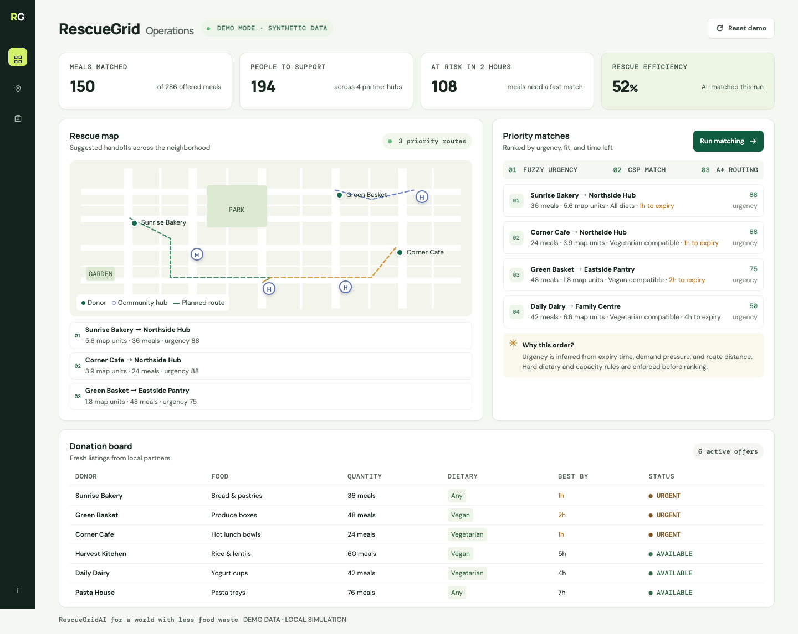

# RescueGrid

A local AI demo for matching surplus food to community partners and planning rescue handoffs. RescueGrid combines fuzzy urgency ranking, a constraint satisfaction problem (CSP), and A* search in one decision flow.

## Run the local demo

```sh
python3 -m http.server 8000
```

Open http://localhost:8000. No network or package installation is required for the app logic. (The optional font is loaded from Google Fonts; system fonts are used offline.)

## Algorithms

1. **Fuzzy inference** scores urgency from food expiry, recipient demand, and route proximity. Linear membership functions scale expiry urgency and route proximity; a triangular function represents demand pressure. Interpretable rules combine the signals.
2. **CSP backtracking** assigns each donation to a diet-compatible hub while respecting per-hub capacity. The assignment solver checks hard constraints; the fuzzy score orders candidate choices and final recommendations.
3. **A* search** plans the shortest path on a small weighted neighborhood graph. Euclidean distance is the heuristic; straight-line edge weights make it admissible and consistent.

All three algorithms support the single objective of rescuing the most time-sensitive food with a feasible recipient and route.

## Demo data and limitations

The listings, demand levels, capacities, and coordinates are synthetic. This is a deterministic educational prototype, not a food-safety tool or a live logistics service. Production use needs verified inventory, safe-handling checks, road-network travel times, privacy controls, and an optimizer for globally maximizing rescued meals.

## Deliverables

The complete submission package at the parent folder includes the technical report, six-slide presentation, 2–3 minute demo video, AI usage declaration, and team contribution statement.


